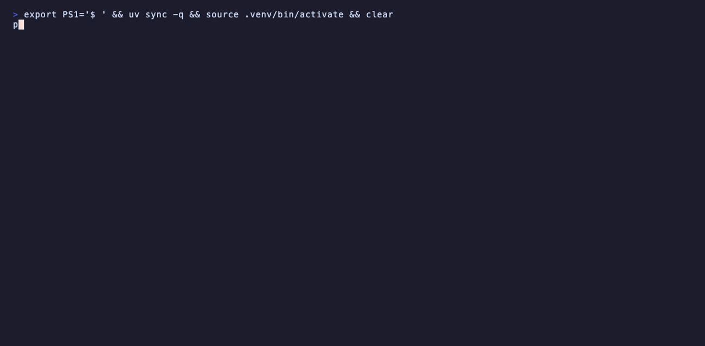
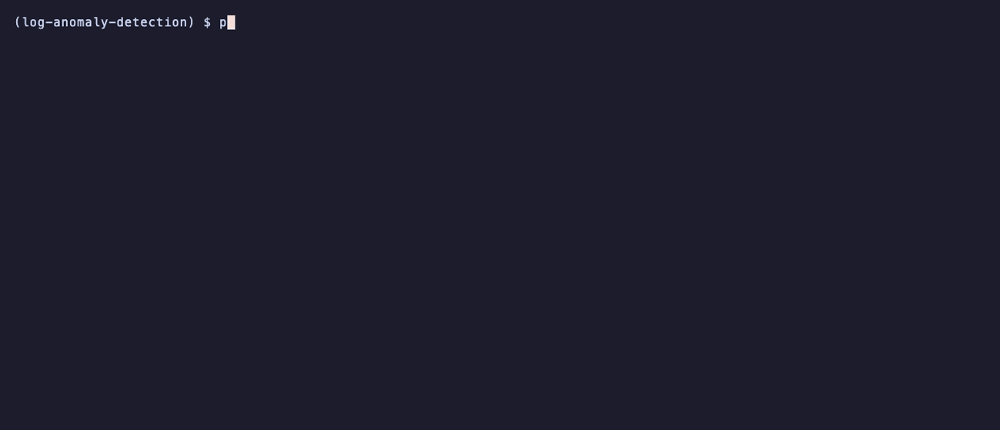
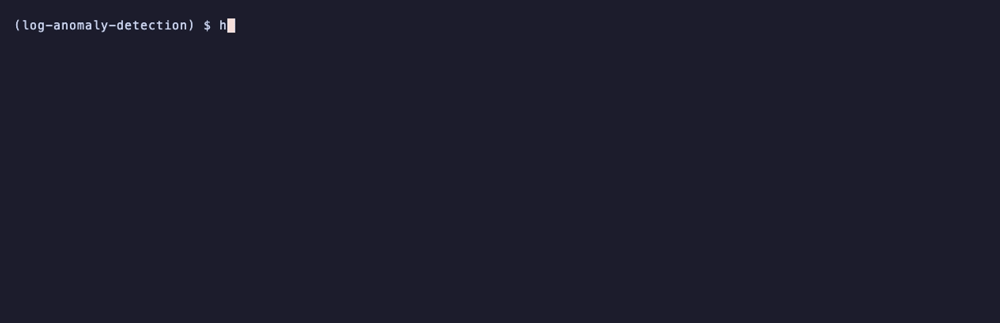

<h1 align="center">Log Anomaly Detection</h1>

<p align="center">
  <em>Log parsing and anomaly detection for large clusters: a Drain parser with a Rust core, six detectors from PCA to a transformer, streaming alerts, and change-point detection for metric regressions, measured on Loghub, Loghub-2.0 and TCPD.</em>
</p>

<p align="center">
  <a href="https://github.com/adeoluo/log-anomaly-detection/actions/workflows/ci.yml"></a>
  <a href="https://github.com/adeoluo/log-anomaly-detection/releases"></a>
  
  
  <a href="LICENSE"></a>
</p>

---

## Motivation

A large cluster writes millions of log lines an hour, and the useful signal is in their structure:
which events happen, in which order and how often. Getting there takes three steps that each have
a standard public benchmark: parse free-text lines into templates (Loghub-2.0), detect anomalous
sessions or time windows from the parsed events (HDFS and BGL), and notice when a performance
metric shifts to a new level after a change (the Turing Change Point Dataset).

This project implements the whole path, with the parser, the detectors and the evaluators written
here and checked against the published reference implementations, and measures every step on the
full public datasets rather than samples. The parser runs on all 50.4 million annotated Loghub-2.0
lines in under three minutes on a laptop, and every number below comes from a script in
`benchmarks/` with its raw output in `benchmarks/results/`.

## Architecture

<p align="center">
  
</p>

<sub>Legend: amber = entry points and external systems, indigo = core logic, green = data and state, blue = validation and control, grey = observability and outputs.</sub>

Lines arrive through the CLI or the HTTP service, which caps request sizes. Each line is split
with its dataset's log format, variables are masked, and the Drain parse tree (Rust, with header
splitting and masking run in parallel chunks) assigns it to a template. Event ids are grouped into
sessions (HDFS block ids) or time windows (BGL) and turned into event-count vectors for PCA,
invariant mining, LogCluster and isolation forest, or into history windows for the DeepLog LSTM
and the transformer. The stream monitor does the same online and raises alerts; CUSUM and BOCPD
watch numeric metrics. Benchmarks score everything against the public ground truth. Module-level
detail is in [docs/ARCHITECTURE.md](docs/ARCHITECTURE.md).

## Results

All runs on an Apple M1 (8 cores, 8 GB RAM), shared with other work. Reproduce with the commands
in each benchmark script's docstring after `scripts/download_data.sh`.

### Log parsing accuracy (Loghub-2k and Loghub-2.0)

Grouping accuracy (GA), F1 of grouping accuracy (FGA), parsing accuracy (PA) and F1 of template
accuracy (FTA), computed exactly as the Loghub-2.0 evaluator computes them (checked digit for
digit against it). Same settings for every engine: the published per-dataset log formats, masks,
depth and similarity threshold. Published Drain numbers are from Jiang et al. (ISSTA 2024,
`RQs_experiments/RQ2` in [logpai/loghub-2.0](https://github.com/logpai/loghub-2.0)), quoted, not
rerun. [`benchmarks/parse_loghub.py`](benchmarks/parse_loghub.py),
[results](benchmarks/results/).

**Loghub-2.0, 14 datasets, 50,416,623 annotated lines:**

| Dataset | Lines | GA | FGA | PA | FTA | Published Drain GA / FGA / PA / FTA | drain3 0.9.11 GA / FGA / PA / FTA |
|---|---:|---:|---:|---:|---:|---|---|
| Proxifier | 21,320 | 0.692 | 0.206 | 0.688 | 0.176 | 0.692 / 0.206 / 0.688 / 0.176 | 0.692 / 0.206 / 0.688 / 0.176 |
| Linux | 23,921 | 0.685 | 0.786 | 0.111 | 0.263 | 0.686 / 0.778 / 0.111 / 0.259 | 0.685 / 0.787 / 0.111 / 0.262 |
| Apache | 51,978 | 1.000 | 1.000 | 0.727 | 0.517 | 1.000 / 1.000 / 0.727 / 0.517 | 1.000 / 1.000 / 0.727 / 0.517 |
| Zookeeper | 74,273 | 0.994 | 0.904 | 0.843 | 0.614 | 0.994 / 0.904 / 0.843 / 0.614 | 0.994 / 0.904 / 0.843 / 0.614 |
| Hadoop | 179,993 | 0.921 | 0.785 | 0.541 | 0.384 | 0.921 / 0.785 / 0.541 / 0.384 | 0.921 / 0.785 / 0.541 / 0.384 |
| HealthApp | 212,394 | 0.862 | 0.010 | 0.312 | 0.004 | 0.862 / 0.010 / 0.312 / 0.004 | 0.862 / 0.010 / 0.312 / 0.004 |
| OpenStack | 207,632 | 0.752 | 0.007 | 0.029 | 0.002 | 0.752 / 0.007 / 0.029 / 0.002 | 0.752 / 0.007 / 0.029 / 0.002 |
| HPC | 429,988 | 0.793 | 0.309 | 0.721 | 0.152 | 0.793 / 0.309 / 0.721 / 0.152 | 0.793 / 0.309 / 0.721 / 0.152 |
| Mac | 100,314 | 0.761 | 0.229 | 0.357 | 0.069 | 0.761 / 0.229 / 0.357 / 0.069 | 0.761 / 0.229 / 0.357 / 0.069 |
| OpenSSH | 638,947 | 0.707 | 0.872 | 0.586 | 0.487 | 0.707 / 0.872 / 0.586 / 0.487 | 0.707 / 0.872 / 0.586 / 0.487 |
| Spark | 16,075,117 | 0.889 | 0.870 | 0.394 | 0.409 | 0.888 / 0.861 / 0.394 / 0.412 | 0.889 / 0.870 / 0.394 / 0.409 |
| Thunderbird | 16,601,745 | 0.831 | 0.237 | 0.216 | 0.071 | 0.831 / 0.237 / 0.216 / 0.071 | 0.831 / 0.237 / 0.216 / 0.071 |
| BGL | 4,631,261 | 0.919 | 0.624 | 0.407 | 0.193 | 0.919 / 0.624 / 0.407 / 0.193 | 0.919 / 0.624 / 0.407 / 0.193 |
| HDFS | 11,167,740 | 0.999 | 0.935 | 0.621 | 0.609 | 0.999 / 0.935 / 0.621 / 0.609 | 0.999 / 0.935 / 0.621 / 0.609 |
| **Average** | | **0.843** | **0.555** | **0.468** | **0.282** | 0.840 / 0.550 / 0.470 / 0.280 | 0.843 / 0.555 / 0.468 / 0.282 |

**Loghub-2k, the same 14 datasets, 2,000 lines each:** average GA 0.853, FGA 0.735, PA 0.311,
FTA 0.271, identical to drain3 and, line for line, to the LogPAI Drain code rerun here with its
own evaluator. The published 2k table averages 0.850 / 0.740 / 0.320 / 0.280; the gap is two
datasets (Spark and HDFS) where the published row differs from what the current LogPAI code
produces on the current files.

What this shows: the parser reproduces the reference Drain. On 12 of the 14 Loghub-2.0 datasets
every metric matches the published figure to three decimals; on Linux and Spark it differs by at
most 0.009 because short messages are stored correctly here (a fix to the LogPAI code; drain3
agrees, see [ADR-0003](docs/adr/0003-follow-logpai-drain-and-evaluator.md)). Accuracy is Drain's,
not better: the point of this parser is speed and exactness, and Drain's low PA and FTA on several
datasets (HealthApp, OpenStack, Mac, Thunderbird) are reported as measured.

### Parsing throughput

End to end on the Loghub-2.0 archives: read each line out of the zip, decompress, split the
header, mask, parse. One process, the same machine, the same lines.

| | Lines | Wall time | Lines per second | Peak memory |
|---|---:|---:|---:|---:|
| **This package (Rust core)** | 50,416,623 | **155.7 s** | **323,771** | 1.27 GB |
| drain3 0.9.11 | 50,416,623 | 1,703.8 s | 29,590 | |
| Published LogPAI Drain (their hardware, not rerun) | 50.4 M | 5,955 s | | |

The Rust core is 5.0x faster than drain3 on HDFS, 5.1x on BGL, about 10x on Spark and Thunderbird, and
89x on HealthApp (28,000 templates, where drain3's per-message overhead dominates). Peak memory
is the whole benchmark process, mostly ground-truth loading for scoring.

**Raw files, a separate run** ([`benchmarks/throughput.py`](benchmarks/throughput.py)). The Rust core parses the whole file; the Python reference and drain3 are timed on the first 500,000 lines.

| Dataset | Engine | Lines timed | Seconds | Lines per second | Peak RSS (MB) |
|---|---|---:|---:|---:|---:|
| HDFS | Rust core, 8 threads | 11,175,629 | 34.96 | 319,688 | 235 |
| HDFS | Rust core, 1 thread | 11,175,629 | 85.16 | 131,236 | 217 |
| HDFS | Python reference | 500,000 | 8.38 | 59,646 |  |
| HDFS | drain3 0.9.11 | 500,000 | 7.55 | 66,266 |  |
| BGL | Rust core, 8 threads | 4,747,963 | 15.23 | 311,729 | 272 |
| BGL | Rust core, 1 thread | 4,747,963 | 69.20 | 68,610 | 150 |
| BGL | Python reference | 500,000 | 12.68 | 39,444 |  |
| BGL | drain3 0.9.11 | 500,000 | 14.19 | 35,230 |  |

On this shared machine absolute speeds vary between runs (the zip-based run above parsed HDFS at
502,111 lines per second, this one at 319,688), so compare rows within a table. With one thread
the Rust core is 2.0x drain3 on HDFS and 1.9x on BGL; the parallel preprocessing adds the rest.
The tree update is sequential, so BGL, with 1,863 templates and long candidate lists per leaf,
gains less from more cores.

### Anomaly detection (HDFS and BGL)

[`benchmarks/anomaly.py`](benchmarks/anomaly.py). The raw logs are parsed with the Rust core,
grouped into HDFS block sessions or 5-minute BGL windows and ordered by time: the first 70 percent
fits the detectors (normal sequences only), the next 10 percent is validation, the last 20
percent is the test set ([ADR-0004](docs/adr/0004-normal-only-training-and-own-decision-rules.md)).
"Own rule" is each method's standard decision rule; "validation threshold" is the score threshold
with the best F1 on the validation part. Test labels never set a threshold. Isolation forest,
DeepLog and the transformer report the mean and standard deviation over seeds 0, 1 and 2.

**HDFS: 11,175,629 lines, 575,061 block sessions; test 115,012 sessions, 1,679 anomalous.**

| Detector | Precision | Recall | F1, own rule | F1, validation threshold | ROC AUC | Average precision |
|---|---:|---:|---:|---:|---:|---:|
| PCA | 0.996 | 0.689 | 0.814 | 0.047 | 0.913 | 0.726 |
| Invariant mining | 0.775 | 1.000 | 0.873 | 0.873 | 0.996 | 0.654 |
| LogCluster | 1.000 | 0.921 | 0.959 | 0.976 | 0.999 | 0.975 |
| Isolation forest | 0.018 ± 0.001 | 0.769 ± 0.031 | 0.036 ± 0.001 | 0.043 ± 0.000 | 0.595 ± 0.001 | 0.018 ± 0.000 |
| DeepLog | 0.720 ± 0.016 | 0.610 ± 0.025 | 0.660 ± 0.021 | 0.386 ± 0.295 | 0.993 ± 0.006 | 0.822 ± 0.037 |
| Transformer | 0.812 ± 0.024 | 0.680 ± 0.129 | 0.735 ± 0.082 | 0.606 ± 0.268 | 0.992 ± 0.006 | 0.832 ± 0.012 |

**BGL: 4,747,963 lines, 14,495 five-minute windows; test 2,899 windows, 225 anomalous.**

| Detector | Precision | Recall | F1, own rule | F1, validation threshold | ROC AUC | Average precision |
|---|---:|---:|---:|---:|---:|---:|
| PCA | 0.385 | 0.462 | 0.420 | 0.218 | 0.820 | 0.303 |
| Invariant mining | 0.094 | 1.000 | 0.171 | 0.346 | 0.761 | 0.489 |
| LogCluster | 0.119 | 0.969 | 0.212 | 0.212 | 0.603 | 0.088 |
| Isolation forest | 0.111 ± 0.157 | 0.002 ± 0.002 | 0.003 ± 0.004 | 0.172 ± 0.027 | 0.690 ± 0.009 | 0.237 ± 0.016 |
| DeepLog | 0.092 ± 0.000 | 1.000 ± 0.000 | 0.168 ± 0.000 | 0.236 ± 0.016 | 0.797 ± 0.065 | 0.344 ± 0.142 |
| Transformer | 0.093 ± 0.001 | 1.000 ± 0.000 | 0.170 ± 0.001 | 0.218 ± 0.015 | 0.788 ± 0.059 | 0.316 ± 0.115 |

What this shows:

* **HDFS:** LogCluster (F1 0.959) and invariant mining (0.873) are the strongest with their own
  rules, and PCA is precise (0.996) but misses 31 percent of failed blocks. DeepLog and the
  transformer rank almost perfectly (ROC AUC 0.99) but the top-9 rule from the DeepLog paper is
  loose for 48 templates plus an end-of-session token and misses about a third of the failures.
* **Validation thresholds do not transfer on HDFS.** The validation period has 3.6 percent
  anomalous sessions of different kinds than the 1.5 percent in the test period, so PCA's tuned
  threshold floods the test set and the neural detectors' tuned F1 swings by seed.
* **BGL is hard under a chronological split.** 65 percent of the test windows (62 percent of the
  normal ones) contain a template never seen in the normal training windows, so the next-event
  models flag every window (recall 1.0, precision 0.09) and the count detectors lose precision.
  Le and Zhang (ICSE 2022) describe the same effect; random splits, which many published BGL
  results use, hide it.
* **Isolation forest** on event counts is weak on both. It matches scikit-learn's IsolationForest
  on HDFS (ROC AUC 0.596 against 0.596 and 0.619 for two seeds), so this is the method under
  normal-only training, not an implementation fault.

### Change-point detection (TCPD and synthetic regressions)

[`benchmarks/changepoint_tcpd.py`](benchmarks/changepoint_tcpd.py) runs every method once per
univariate series of the Turing Change Point Dataset with default parameters (no tuning on the
annotations), scored with the benchmark's F1 (margin 5) and covering. The TCPDBench rows are the
published per-series scores (van den Burg and Williams, 2020) averaged over the same series; the
"zero" row (no change points) matches the published one exactly, which checks the metric code.

| Method | F1 | Cover | Source |
|---|---:|---:|---|
| BOCPD (this package) | 0.692 | 0.624 | run here |
| CUSUM (this package) | 0.535 | 0.495 | run here |
| ruptures Pelt (l2, penalty 2 log n) | 0.708 | 0.665 | run here |
| ruptures Binseg (l2, penalty 2 log n) | 0.717 | 0.668 | run here |
| No change points | 0.658 | 0.573 | run here |
| bocpd (R ocp) | 0.693 | 0.630 | TCPDBench, published, 37 series |
| pelt (R changepoint) | 0.710 | 0.684 | TCPDBench, published, 37 series |
| binseg (R changepoint) | 0.736 | 0.701 | TCPDBench, published, 37 series |

[`benchmarks/changepoint_regressions.py`](benchmarks/changepoint_regressions.py) imitates per-build
latency: 300 seeded series, 458 level shifts of 3 to 30 percent, 2 to 6 percent noise and 1
percent spikes. A detection counts within 5 points.

| Method | F1 | Precision | Recall | False alarms per series | Recall, 3-10% shifts | Recall, 20-30% shifts |
|---|---:|---:|---:|---:|---:|---:|
| CUSUM | 0.736 | 0.650 | 0.901 | 1.34 | 0.450 | 0.919 |
| BOCPD | 0.453 | 0.321 | 0.970 | 6.11 | 0.730 | 1.000 |
| CUSUM + 3-point median | 0.575 | 0.458 | 0.898 | 3.41 | 0.757 | 0.808 |
| BOCPD + 3-point median | 0.758 | 0.711 | 0.988 | 2.28 | 0.883 | 1.000 |
| ruptures Pelt (l2) | **0.900** | 0.908 | 0.934 | 0.30 | 0.523 | 1.000 |
| ruptures Pelt + 3-point median | 0.888 | 0.878 | 0.960 | 0.42 | 0.658 | 1.000 |

What this shows: BOCPD here matches the published R implementation on TCPD (0.692 against 0.693
F1). Offline Pelt is the more accurate choice when the whole history is available, on both
benchmarks; CUSUM is the cheap online option (0.3 s for all 300 series) and BOCPD finds the most
small shifts but needs spike filtering (the same median filter hurts CUSUM, 0.736 to 0.575 F1), which `detect_regressions` does by dropping segments
shorter than 3 points.

### Comparison scope

* Parsing is compared with published Drain and with drain3 on identical inputs and settings. Other
  parsers (for example LLM-based ones in the Loghub-2.0 study) were not run.
* Published anomaly-detection numbers use different splits and threshold choices, so they are
  references, not a leaderboard: on HDFS, He et al. (ISSRE 2016, LogPAI loglizer) report F1 0.79
  for PCA, 0.91 for invariant mining and 0.80 for LogCluster, and Du et al. (CCS 2017) report
  0.96 for DeepLog. None of these were rerun.
* Timings come from a laptop shared with other jobs, so they vary between runs; speed comparisons
  are made within one run.

## Quickstart

```bash
git clone https://github.com/adeoluo/log-anomaly-detection.git && cd log-anomaly-detection
make setup        # uv sync (compiles the Rust core; needs a Rust toolchain) + pre-commit
make all          # lint + type-check + tests with the coverage gate

# parse a log and list its most frequent templates
python -m log_anomaly_detection parse tests/fixtures/loghub_2k/HDFS_2k.log.gz --dataset HDFS

# parsing accuracy on the bundled Loghub-2k samples
python -m log_anomaly_detection parse-eval --data-dir tests/fixtures/loghub_2k
```

The neural detectors need PyTorch: `uv sync --extra deep`.

## Usage

### CLI

| Command | What it does |
|---|---|
| `parse FILE [--dataset NAME \| --format F --mask R]` | Parse a log (plain or `.gz`), print templates and throughput |
| `parse-eval --data-dir DIR [--full]` | GA, FGA, PA, FTA on Loghub-2k folders or Loghub-2.0 zips |
| `detect --dataset hdfs\|bgl --log FILE [--labels CSV] --detectors ...` | Train and score detectors with the evaluation protocol |
| `stream --train FILE --input FILE\|-` | Learn from history, then parse a live stream and print alerts |
| `regress FILE [--column C] [--method cusum\|bocpd]` | Level shifts in a metric series |
| `serve [--train FILE]` | HTTP service |

### Library API

```python
from log_anomaly_detection import LogParser
from log_anomaly_detection.formats import settings_for
from log_anomaly_detection.datasets import load_hdfs
from log_anomaly_detection.evaluation import evaluate_dataset
from log_anomaly_detection.changepoint import detect_regressions

parser = LogParser.for_dataset(settings_for("HDFS"))  # Rust core by default
ids = parser.add_lines(open("HDFS.log"))  # one event id per line
print(parser.templates()[ids[0]])

data = load_hdfs("HDFS.log", "anomaly_label.csv")  # 575,061 block sessions
report = evaluate_dataset(data, ["pca", "invariants", "deeplog"])

detect_regressions([120, 121, 119, 135, 134, 136, 135], direction="up", min_relative=0.05)
```

### Streaming and alerts

`StreamMonitor` keeps one parser for its life: it trains on a historical log (dropping sessions
labelled anomalous if labels are given), then parses each new line, appends it to its session
(HDFS block) or window, scores sessions when they go idle, and raises an alert when the detector's
rule fires. Templates first seen after training are marked `[new]`, and a CUSUM on the share of
such lines raises a `rate` alert when it shifts up.

### HTTP service

```bash
python -m log_anomaly_detection serve --train HDFS.log --train-lines 300000 --labels anomaly_label.csv
curl -s -X POST localhost:8000/parse  -d '{"lines": ["081109 203518 143 INFO dfs.DataNode: Receiving block blk_1"]}'
curl -s -X POST localhost:8000/ingest -d '{"lines": [...], "flush": true}'
curl -s -X POST localhost:8000/regress -d '{"values": [120, 121, 119, 135, 134, 136], "direction": "up"}'
curl -s localhost:8000/metrics
```

`GET /health`, `GET /ready` (503 until a detector is trained), `GET /metrics` (Prometheus text:
requests and latency per route, lines ingested, alerts, templates, open sessions), `GET /templates`,
`POST /parse`, `/ingest`, `/score`, `/regress`. Settings come from `LAD_*` environment variables
(see `.env.example`); the service binds to 127.0.0.1 and caps bodies at 4 MB.

### Demos

Recorded from real runs with [vhs](https://github.com/charmbracelet/vhs); each tape is in `docs/demo/`.

Parsing accuracy on the 14 bundled Loghub-2k datasets.

<p align="center">
  
</p>

Training on the first million HDFS lines, then streaming the next 200,000 and alerting on failed blocks.

<p align="center">
  
</p>

The HTTP service ingesting 20,000 HDFS lines, returning alerts, and exporting its metrics.

<p align="center">
  
</p>

Finding a latency regression and its fix in a per-build metric with CUSUM and BOCPD.

<p align="center">
  
</p>

## Design decisions

- **A Rust parser that reproduces the Python reference exactly.** Header splitting and masking run
  in parallel chunks and tree updates stay sequential, so results are identical and checked in
  CI. ([ADR-0002](docs/adr/0002-rust-drain-core-with-parity.md))
- **Follow the LogPAI Drain and the Loghub-2.0 evaluator, with one fix.** Comparable numbers need
  identical semantics; short messages are now stored correctly.
  ([ADR-0003](docs/adr/0003-follow-logpai-drain-and-evaluator.md))
- **One protocol for every detector.** Chronological split, normal-only training, each method's
  own rule plus a validation threshold, never a test-tuned one.
  ([ADR-0004](docs/adr/0004-normal-only-training-and-own-decision-rules.md))
- **CUSUM and BOCPD for regressions**, compared with ruptures on public and synthetic data.
  ([ADR-0005](docs/adr/0005-change-point-detectors.md))
- **Score distinct sequences once.** Logs repeat, so deduplicated scoring and window counts make
  full-dataset runs cheap without changing results. ([ADR-0006](docs/adr/0006-dedupe-before-scoring.md))

## Testing

```bash
make lint        # ruff format --check and ruff check
make type        # mypy src (strict)
make test        # pytest
make coverage    # pytest with the 80% coverage gate
make rust-check  # cargo fmt, clippy, cargo test
make parity      # Rust vs Python parity, extension required
```

167 Python tests and 8 Rust unit tests:

- `test_rust_parity.py`: Rust and Python assign identical cluster ids and templates on all 14
  Loghub-2k datasets, on 200 random batches of lines with mixed Unicode whitespace, masks and
  settings (Hypothesis), across chunk boundaries, and for file parsing with sessions, labels and
  timestamps.
- `test_loghub.py`, `test_parsing_metrics.py`: GA, FGA, PA and FTA pinned to the LogPAI
  reference on every Loghub-2k dataset, hand-computed cases, properties (a perfect parse scores 1,
  grouping ignores names), streaming from zip archives.
- `test_drain.py`, `test_formats.py`: tree routing, similarity ties, `max_children` overflow,
  short messages, invalid settings, and properties (every template covers its messages).
- `test_features.py`, `test_metrics.py`: CSR sequences, time and count windows (Hypothesis checks
  that every line lands in a window that contains its time), count matrices, ROC AUC against the
  pairwise definition.
- `test_detectors.py`, `test_sequence.py`: each detector on a workflow with planted invariants,
  DeepLog and the transformer learning a workflow and catching reordering, unseen events and
  truncated sessions, reproducibility, and opt-in checks against scikit-learn.
- `test_changepoint.py`: the TCPD metric reference values, CUSUM and BOCPD on level shifts, online
  APIs, spike handling, and a ruptures cross-check.
- `test_streaming_service.py`, `test_cli.py`: alerts on failed sessions, idle closing, window and
  rate alerts, every HTTP route and error over the handler and a real socket, and each CLI
  command.

CI runs format, lint, type check and the coverage-gated tests on Python 3.11 and 3.12 with the
Rust extension required, a Rust job (fmt, clippy with and without the Python feature, unit tests,
parity), and builds the package and Docker image. CodeQL runs on pushes to main and weekly.

## Responsible AI

- **Model card:** [docs/MODEL_CARD.md](docs/MODEL_CARD.md)
- **Data card:** [docs/DATA_CARD.md](docs/DATA_CARD.md)
- **Threat model:** [docs/THREAT_MODEL.md](docs/THREAT_MODEL.md)
- **Evaluation report:** [docs/EVALUATION_REPORT.md](docs/EVALUATION_REPORT.md)

Alerts carry masked templates and scores rather than raw lines. The detectors learn what normal
looked like in a training period; they are aids for operators, not automated decision makers.

## Limitations

- Accuracy is Drain's: parsing accuracy (PA) is low on several datasets because masked tokens and
  punctuation differ from the annotated templates.
- Detectors trained on one period degrade when the software changes; BGL's chronological split
  shows this clearly. Retrain after upgrades.
- Isolation forest on event counts is weak on these datasets with normal-only training (it agrees
  with scikit-learn's implementation, so this is the method, not a bug).
- The HTTP service has no authentication; put it behind a proxy if it leaves localhost.
- Building from source needs a Rust toolchain; the neural detectors need PyTorch.

## Roadmap

- [x] Drain in Rust with exact parity and parallel preprocessing
- [x] Six detectors, one protocol, full HDFS and BGL
- [x] Streaming monitor, HTTP service, change-point regressions
- [ ] Persist trained monitors (parser tree and detector) instead of retraining at startup
- [ ] Thunderbird and Spark anomaly benchmarks with the same protocol
- [ ] A parser with learned or LLM-assisted templates for the low-PA datasets

## License

Released under the [MIT License](LICENSE).
