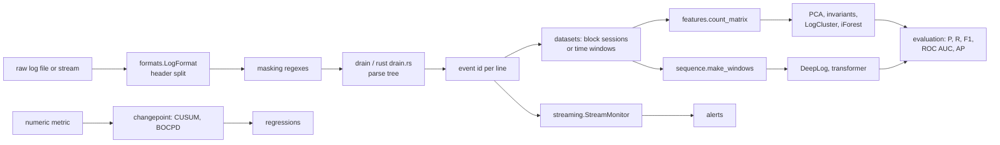

# Architecture

The rendered overview is [architecture/architecture.svg](architecture/architecture.svg) (source:
[architecture/architecture.mmd](architecture/architecture.mmd)). This page adds the data flow at
the level of modules.

## Modules

| Module | Responsibility |
|---|---|
| `formats.py` | Log format to anchored regex; LogPAI per-dataset settings |
| `drain.py` | Reference Drain parser (Python) |
| `rust/src/drain.rs`, `pipeline.rs` | Drain in Rust; chunked parallel file parsing with session, label and time extraction |
| `parser.py` | `LogParser`: one API over both backends, file and batch parsing |
| `parsing_metrics.py`, `loghub.py` | GA, FGA, PA, FTA; Loghub-2k and Loghub-2.0 runners (zips streamed) |
| `datasets.py` | HDFS block sessions and BGL windows from raw logs |
| `features.py` | CSR sequences, grouping, time and count windows, count matrices, TF-IDF |
| `detectors/` | PCA, invariant mining, LogCluster, isolation forest, DeepLog, transformer |
| `evaluation.py`, `metrics.py` | Chronological normal-only protocol; P, R, F1, ROC AUC, AP |
| `streaming.py` | Online parsing, sessionizing, scoring, alerting, unknown-template rate CUSUM |
| `changepoint.py` | CUSUM, BOCPD, regression summaries, TCPD F1 and covering |
| `service.py`, `observability.py` | HTTP service and Prometheus metrics |
| `cli.py` | `parse`, `parse-eval`, `detect`, `stream`, `regress`, `serve` |

## Concurrency

The Rust file parser reads 65,536 lines at a time and preprocesses them on all cores with rayon
(header regex, masks, tokenization), releasing the GIL. Tree updates are sequential and in input
order, which keeps results identical to the Python reference. The HTTP service is a threading
server; requests that touch the parser or the stream monitor hold one lock.

## Memory

Nothing holds a whole log in memory. HDFS (1.58 GB) parses into a 45 MB array of event ids plus
packed session pairs; sequences are kept in CSR form (one flat array plus offsets). Loghub-2.0
archives are streamed straight out of the zip files.
